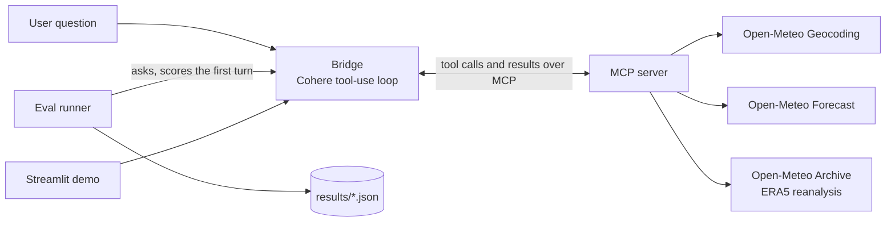

# climate-mcp-evals

A tool-using LLM agent for weather and climate data, and an eval harness that measures how well it picks and chains its tools.

An MCP server exposes Open-Meteo forecasts and ERA5-based historical weather as tools. A bridge connects those tools to a Cohere model and runs the tool-use loop. An eval runner asks the model a fixed set of questions and scores its first decision: the right tool, with the right arguments.

The weather data is the vehicle. The point is the integration work around it: tool schemas a model can use reliably, errors a model can recover from, and a repeatable way to measure tool-selection quality.



## Example

```
$ python bridge/run.py
[turn 0] geocode_city {"name": "Ankara", "country_code": "TR"}
[turn 1] get_forecast {"latitude": 39.91987, "longitude": 32.85427, "days": 2}

Answer: Based on the weather forecast for Ankara, tomorrow (November 27, 2026) will not rain.
The forecast shows 0 mm of precipitation for that day, with a high of 8.5°C and a low of -1.1°C.
```

The model does not know Ankara's coordinates, so it geocodes first, then calls the forecast tool with the result, then answers from the returned data.


## Status

| Part | State |
|---|---|
| MCP server with three tools | Done |
| Bridge: MCP client + Cohere tool-use loop | Done |
| Eval runner, 24 cases, v1 baseline | Done |
| Streamlit demo showing each tool call | Done |
| Harder eval cases (relative dates, out-of-range requests, mixed language) | Next |
| Tool-description tuning rounds | Planned |
| TypeScript server, same evals against both | Planned |
| CI: evals on every pull request | Planned |

## Tools

| Tool | What it does | Source |
|---|---|---|
| `geocode_city` | Turns a place name (optionally filtered by country) into coordinates | Open-Meteo Geocoding API |
| `get_forecast` | Daily forecast from today up to 16 days ahead | Open-Meteo Forecast API |
| `get_historical` | Observed daily weather for any range from 1940 up to yesterday | Open-Meteo Historical Weather API (ERA5 reanalysis) |

The data tools take coordinates, so a question about a named place needs two calls: `geocode_city`, then the right data tool. Full schemas, limits and output examples are in [docs/tools.md](docs/tools.md).

## Evaluation

### What is measured

For each case the runner sends one question to the model with all three tools available and inspects the tool calls in the model's **first turn**:

- **Tool accuracy:** did it call the expected tool (or no tool, when none is needed)?
- **Argument accuracy:** do the arguments the question fully determines match? Arguments the question leaves open (for example `days` for "tomorrow") are not checked.

Cases fall into six categories: `clear`, `boundary` (forecast vs history), `chain` (place name, so geocode first), `arguments`, `parallel` (several independent calls expected in one turn) and `no_tool`.

### Design choices

- **First turn only.** One API call per case keeps a full run inside the trial key's limits (about 20 chat calls per minute, 1,000 per month) and isolates the decision being measured.
- **Coordinates in boundary cases.** A question that names a place always starts with `geocode_city`, which would hide the forecast/history decision. Boundary cases give coordinates, so the model has to choose the data tool directly. Chaining is tested separately with place names.
- **A fixed "today".** The system prompt pins the date to 2026-11-26, so "yesterday" and "tomorrow" always mean the same dates and expected arguments never drift.
- **Tolerant comparisons.** Coordinates match within ±0.5° (Open-Meteo snaps to grid points), lists match in any order, and strings ignore case and accents ("İzmir" equals "Izmir").
- **Parallelism counts.** In `parallel` cases all expected calls must appear in the first turn. Calling them one per turn still answers the question, but costs extra round trips, so it is scored as a miss.
- **Temperature 0**, and a held-out set (`evals/holdout.yaml`, one case per category) that is not looked at while tuning tool descriptions.

### Results

| Run | Cases | Tool | Arguments | Notes |
|---|---|---|---|---|
| v1 baseline | 24 | 23/24 | 23/24 | Before the held-out split. Only miss: `parallel-03` |

Model: `command-a-plus-05-2026`. Raw results, including every call the model made, are in [results/](results/).

The one miss is informative: asked to compare yesterday's high with today's forecast at one location, the model called `get_historical` alone and would have called `get_forecast` in a second turn. It answers correctly, just sequentially.

A 96% baseline also means the current cases are too easy to show the effect of tuning. The next step is a harder set: relative dates ("last weekend", "next Monday"), requests outside the tools' ranges ("in three weeks", "in 1930"), questions spanning both sides of the boundary, and mixed-language questions.

## Design decisions

- **A hard boundary between forecast and history.** Both Open-Meteo endpoints can return today, which would leave the model guessing. Both tool descriptions state the rule: yesterday and earlier → `get_historical`; today and later → `get_forecast`.
- **Errors are returned, not raised.** An unhandled exception reaches the model as a bare "Error executing tool". Every tool instead returns `{"error": "..."}` with a reason the model can act on, such as *"end_date must be before today. For today or future dates, use get_forecast."* Open-Meteo's own error reasons are passed through.
- **Variables are an enum, not free text.** `variables` accepts only `temperature_max`, `temperature_min`, `precipitation` and `wind_speed_max`, so the model cannot invent names. The tools map these to Open-Meteo's names internally, which keeps the schema stable if the data source changes. A bare `list` type produced a schema with no constraints on its items, which some MCP clients reject.
- **Reshaped output.** Open-Meteo returns parallel lists. The tools return one object per day, with units in the field names (`temperature_max_c`, `precipitation_mm`), and only the variables that were asked for.
- **Filtering is delegated to the API.** `geocode_city` passes `countryCode` to Open-Meteo instead of checking the first result itself, so "Paris, US" finds Paris, Texas rather than failing on Paris, France.
- **The tools report where the data really comes from.** Open-Meteo snaps requests to the nearest grid point, and the forecast and archive endpoints use different grids (Ankara at 39.93, 32.86 came back as 39.904, 32.859 from forecast and 39.965, 32.807 from archive).
- **The bridge knows no tool by name.** It lists the server's tools over MCP at start-up and converts their JSON Schemas to Cohere's format. Adding a tool to the server, or swapping in another server, needs no change in the bridge.
- **Defensive parsing of responses.** The server returns tool results as text rather than structured content, so the bridge falls back to parsing the text blocks. The model's reply can start with a thinking block, so the bridge reads only text blocks rather than assuming the first one.
- **Pinned to MCP Python SDK v2.** Version 2.0 renamed `FastMCP` to `MCPServer` and broke unpinned v1 code. `requirements.txt` pins `mcp>=2,<3`.

## Setup

Requires Python 3.10+ and Node.js (for the MCP Inspector).

```bash
git clone https://github.com/EceOzen/climate-mcp-evals.git
cd climate-mcp-evals
python -m venv .venv            # or: conda create -n climate-mcp python=3.11
# activate the environment, then:
pip install -r requirements.txt
```

Put a Cohere API key in a `.env` file in the repo root (it is git-ignored):

```
COHERE_API_KEY=your_key_here
```

The server itself needs no key: Open-Meteo is free for non-commercial use.

## Usage

```bash
# Inspect the server's tools interactively
npx @modelcontextprotocol/inspector python server/server.py

# Ask the agent one question end to end
python bridge/run.py

# Run the evals
python -m evals.run_eval
python -m evals.run_eval --cases evals/holdout.yaml --out results/holdout.json --label "holdout"

# Chat with the agent in the browser and watch each tool call
python -m streamlit run demo/app.py
```

## Roadmap

1. Harder eval cases, and several runs per case to measure stability.
2. Tool-description tuning rounds, one change per round, with the score recorded. First candidates: moving parameter descriptions into the JSON Schema (they currently live only in the description text), and nudging the model to issue independent calls in parallel.
3. Typed tool outputs (`TypedDict` or Pydantic) so the server returns structured content and an output schema.
4. A TypeScript version of the server, with the same evals run against both.
5. CI that runs the evals on every pull request and flags regressions.

## Data attribution

Weather data by [Open-Meteo.com](https://open-meteo.com/), licensed under CC BY 4.0. Historical data is based on ERA5 reanalysis from the Copernicus Climate Change Service (ECMWF).
